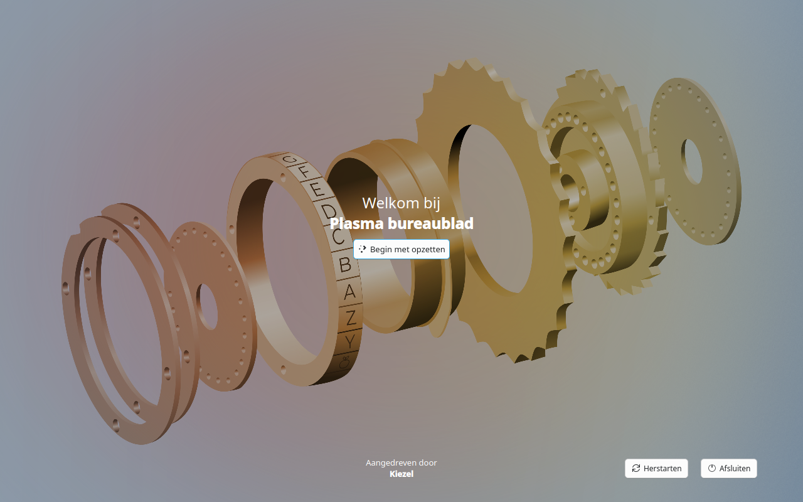
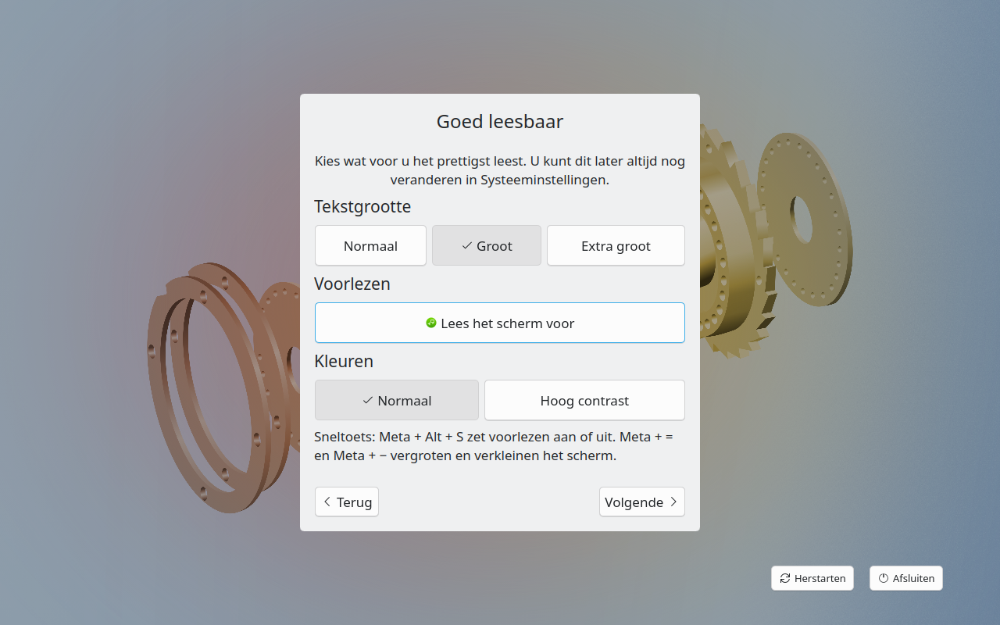
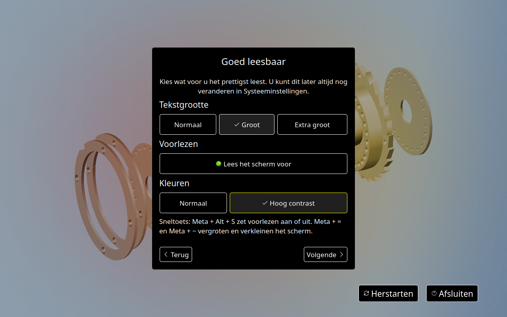
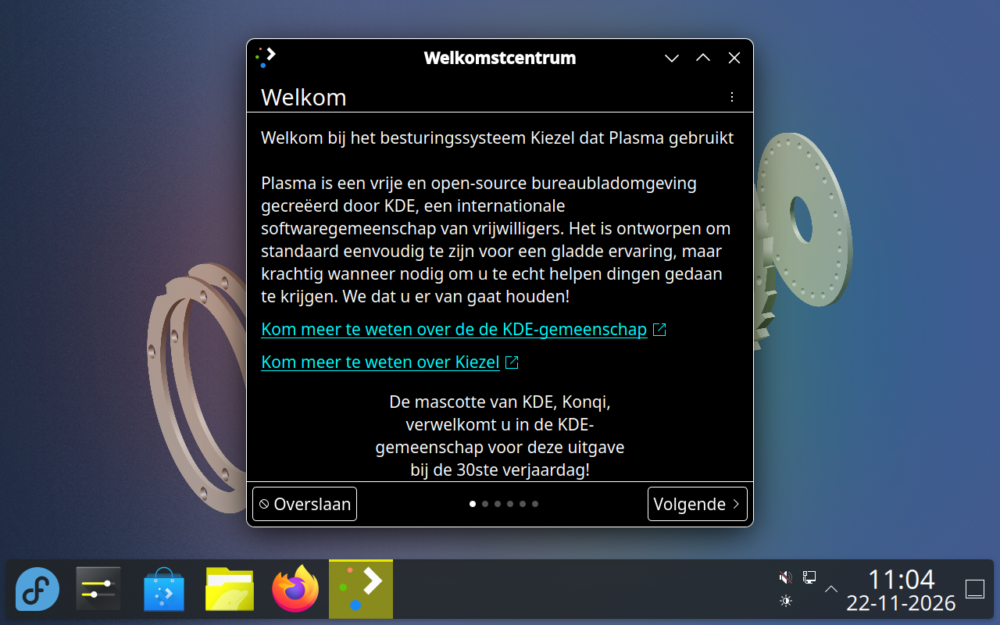
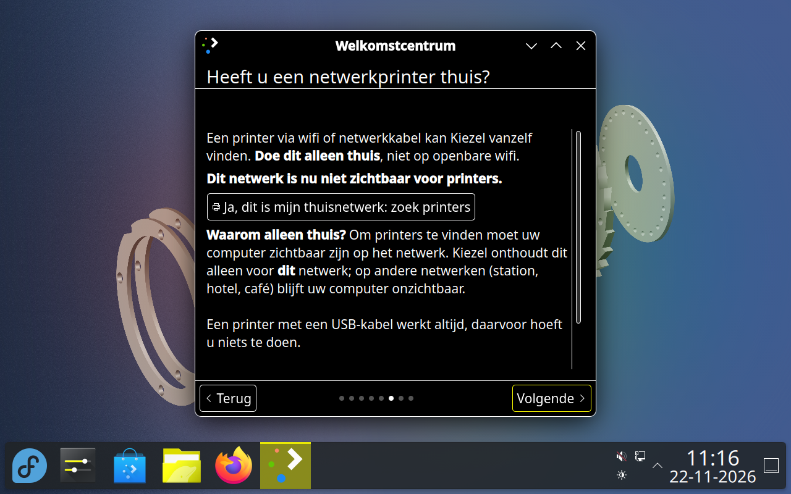
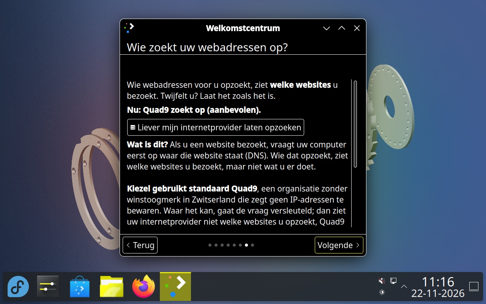
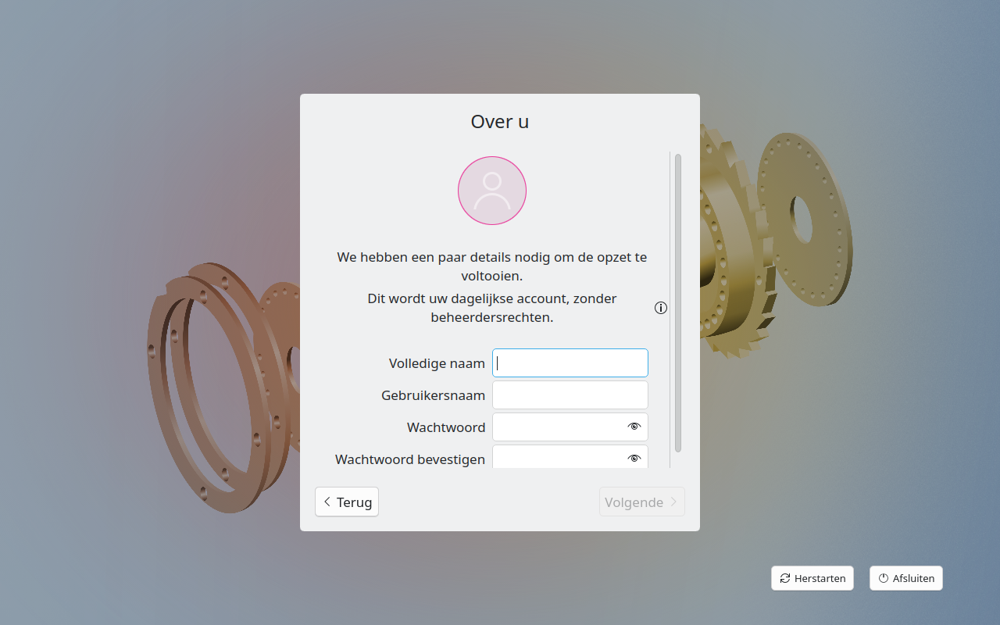
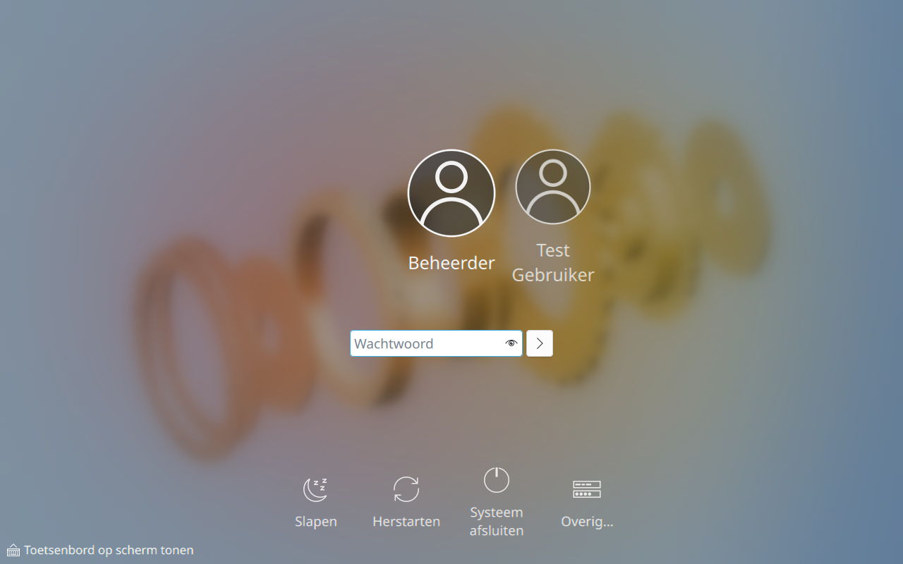
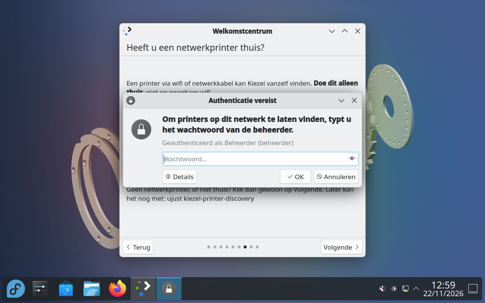

# ADR-0007: First-run experience — KDE Plasma Setup plus Welcome Center extra pages, no custom wizard

- **Status:** Accepted (details settled in Phase 3)
- **Date:** 2026-11-21
- **Phase:** 0

## Context

The requirement is a first-start wizard with these steps:

- language
- font size (large or extra large)
- contrast
- Wi-Fi
- account
- profile

Before building our own QML wizard, check what KDE ships. Checked 2026-11-21 on invent.kde.org:

- **Plasma Setup** (formerly KISS) is KDE's own first-run wizard. It first shipped with Plasma
  6.6 and runs before the first login, OEM-style. It has modules for language, keyboard, time,
  Wi-Fi, account, hostname and a finish page, built as KPackage modules (`src/packagestructure`).
  Fedora packages it.
- **Plasma Welcome** (Welcome Center) runs after the first login. It officially supports
  **distro extra pages**: QML files in `/usr/share/plasma/plasma-welcome/extra-pages/NN-Name.qml`
  that can open settings modules and run commands. It also supports a custom intro text and
  image.

## Decision

1. **Before login: Plasma Setup** handles language (nl_BE preselected), keyboard, Wi-Fi,
   time and account. These are system tasks, so we use KDE's code and its translations.
2. **After the first login: Plasma Welcome** with Kiezel extra pages:
   - text size
   - contrast
   - profile (Simple, Standard, Advanced)
   - accessibility (Orca, magnifier, text-to-speech), each turned on with one click
3. **Only if** Plasma Setup cannot take a custom module for font size or profile *before*
   login (to be checked in Phase 3) do we write a **Plasma Setup module**. That would still not
   be a separate application.

## Consequences

- Much less code to maintain, translated by KDE into nl and many other languages, and it looks
  native.
- Plasma Welcome pages are skippable by design, so they must not be the only way to change
  these settings. The same options are always available in System Settings and via `ujust`.
- Open question for Phase 3: the account Plasma Setup creates needs to be the **daily account
  without admin rights**, with the admin account created by the installer. We need to verify
  how Plasma Setup's account module assigns groups.

## Spike results (Phase 1, 2026-11-21)

Checked in the shipped package (`plasma-setup-6.8.3-1.fc45`, already in the base image and
enabled through Fedora's preset) and in the upstream source at commit `12378c7`. These are
source and package findings. The on-screen run in a VM, with screenshots, is still open.

| Question | Finding | Consequence for Kiezel |
|---|---|---|
| Is it in the image? | Yes. `plasma-setup.service` runs before the display manager while `/etc/plasma-setup-done` is absent. | Nothing to install. |
| Can we add our own page? | Yes, officially: KPackages of type `KDE/PlasmaSetup`, ordered by weight, QML-only allowed (`docs/CUSTOM_MODULES.md`). | A **Kiezel module** for text size, contrast and screen reader can come *before* the account step, so the user sees large text from the start. |
| Screen reader (Orca) | The setup session's shortcut allow-list explicitly permits `toggleScreenReader` (Meta+Alt+S) and the KWin zoom shortcuts. **There is no on-screen button.** | Our module adds a big "Read the screen aloud" button. Orca and zoom shortcuts already work. |
| Text size or scaling | The scaling selector is **commented out upstream** (TODO, MR !56). | Our module provides text size: Large or Extra large. |
| Account type | The created user joins the groups from `/etc/xdg/plasmasetuprc` `[Accounts] UserGroups`. **An empty value falls back to `wheel` (admin).** The page also always shows the text "This user will be an administrator." | Set `UserGroups` to non-admin groups. The admin label must be fixed: either an upstream patch that makes it depend on `wheel`, or our own account page. **Open item for Phase 3.** |
| Admin already created by the installer | Plasma Setup **hides the account step** when a regular user exists, unless `PLASMA_SETUP_USER_CREATION_OVERRIDE=1` is set. | Set that variable for the service, so that the installer creates the admin and Plasma Setup creates the daily user. |

### On-screen run (2026-11-21, freshly installed system from the CI-test ISO)

- Plasma Setup starts on first boot, in Dutch, and shows "Aangedreven door **Kiezel**" (from
  our os-release).
- **Orca works before the first login:** after Meta+Alt+S, `orca.service` and
  `speech-dispatcher` start in the setup session (journal). There is still no visible button.
- **Accessibility gap confirmed:** at 1280×800 the "Begin met opzetten" button and the text are
  small, so the Kiezel module for text size must come first (Phase 3).
- **Bug found: Plasma Setup overwrites the installer's region.** At start-up it maps `nl_BE`,
  which has no separate translation, to the base language `nl`. It then calls
  `SetLocale(QLocale("nl").name())`, which gives **`nl_NL`**, and so replaces nl_BE with
  Dutch-Netherlands formats for the whole system. This affects every regional locale without
  its own translation (fr_BE, de_AT, ...). Source:
  `modules/languageutil/languageutil.cpp`, `overrideInitialLanguageIfNeeded()` followed by
  `applyLanguageAsSystemDefault()`.
  **Kiezel workaround:** `kiezel-locale-capture.service` saves the installer's LANG before
  Plasma Setup runs. `kiezel-locale-restore.path` restores the *region* after setup, but only
  when the language is unchanged (nl→nl). A different language chosen in Plasma Setup is kept.
  **Reproduced on vanilla Fedora Kinoite 45** (no Kiezel changes; `tests/upstream-repro/`):
  "System language detected as: nl_BE" → "Overriding to base language nl" → "Successfully set
  system default language" → `LANG=nl_NL.UTF-8`. Related upstream report: KDE bug 516378 (missing
  regional variants). Report text prepared for the owner to file (product "Plasma Setup").

## Phase 3 implementation: the "Easy to read" page (2026-11-22)

Point 3 of the decision applies: Plasma Setup has no text size option (scaling is commented out
upstream), so Kiezel ships a **Plasma Setup module** (`org.kiezel.plasmasetup.accessibility`,
QML only, `X-KDE-Weight: -10`, so it is the **first** page):

| Choice | Options | Default | Applied by |
|---|---|---|---|
| Text size | Normal (10 pt), Large (13 pt), Extra large (16 pt) | **Large**, applied as soon as the page appears | `kdeglobals` font keys |
| Colours | Normal (Breeze Light), High contrast (white on black, yellow focus) | Normal | `plasma-apply-colorscheme`; scheme `KiezelHighContrast` ships in the image |
| Read aloud | big on/off button; Meta+Alt+S keeps working | Off | `orca.service` now; `kaccessrc` in the new account |

How the choices reach the new account: Plasma Setup copies the setup session's `kdeglobals`
and `kwinrc` to the account it creates (`setnewuserglobaltheme`, `setnewuserdisplayscaling` in
its KAuth helper). Text size and colours are native `kdeglobals` keys, so they carry over as is.
The screen reader lives in `kaccessrc`, which is not copied, so the page also records
`[Kiezel] ScreenReader=true` in `kdeglobals`. The autostart entry
`kiezel-a11y-first-login.desktop` applies it once in the new account. The page runs
`/usr/libexec/kiezel/a11y-apply` through the plasma5support executable engine.

Strings are bilingual (Dutch for `nl*` locales, English otherwise), so no translation catalogue
is needed. The page comes before Plasma Setup's language page; the installer has already set the
system language.

Tests:

- Image checks: the page is discovered by `kpackagetool6`, has the lowest weight, the executable
  engine is present, and `a11y-apply` writes the expected keys.
- `qmllint` is clean.

### On-screen run (2026-11-22, installed CI-test disk, files added with `bootc usr-overlay`)

What was checked, in order:

1. The page is the **first** page, titled "Goed leesbaar". "Groot" is already applied when it
   appears.
2. "Extra groot" enlarges all text **live**, and the page scrolls when it no longer fits.
3. "Voorlezen" starts Orca and speech-dispatcher in the setup session.
4. "Hoog contrast" switches live; borders are white (measured on the screenshot).
5. The following Plasma Setup pages (language, account, ...) keep extra-large text and high
   contrast.
6. After the account is created, its `kdeglobals` holds the text size, the colour scheme and
   `[Kiezel] ScreenReader=true`.
7. After the first login, the desktop is in high contrast with extra-large text, **Orca is
   running**, `kaccessrc` has the screen reader enabled, and `FirstLoginApplied=true` is set.

Three problems were found and fixed during this run:

- **No live font update.** The legacy `KGlobalSettings.notifyChange` signal is ignored in Plasma 6.
  The script now sends `org.kde.KDEPlatformTheme.refreshFonts`.
- **Weak borders in high contrast.** They measured (51,51,51) on black, about 1.7:1, which fails
  WCAG 1.4.11's 3:1. `plasma-apply-colorscheme` overwrites `[KDE] frameContrast` with the
  scheme's value, so `frameContrast=1.0` now lives in the colour scheme itself.
- **The screen reader choice would have been lost.** The first-login autostart also ran in Plasma
  Setup's own session, marked itself done, and that mark was copied to the new account. It now
  skips the `plasma-setup` user.

Open items:

- The **login screen** (plasmalogin greeter) still uses normal text and colours. It is
  system-wide; making it follow the choice needs a privileged step. Phase 3 follow-up.
- If Plasma Setup restarts mid-way, the page shows its defaults rather than the choices already
  applied. Harmless on a real first boot.
- The created account is still an **administrator** (`wheel`). The non-admin daily account is a
  separate Phase 3 item.

## Phase 3: Welcome Center pages (2026-11-22)

Two Kiezel pages are added to Plasma Welcome
(`/usr/share/plasma/plasma-welcome/extra-pages/`) after the first login:

1. **"Heeft u een netwerkprinter thuis?"** One button opens printer discovery for **this
   network only** (firewall zone `kiezel-home`), and one button undoes it. The page explains why
   to do this only at home.
2. **"Wie zoekt uw webadressen op?"** It shows the DNS privacy trade-off from ADR-0012 and
   offers one switch: Quad9 (recommended) or the internet provider.

Design rules learned on screen:

- Plasma Welcome's page header (description plus `topContent`) **does not scroll**. With extra
  large text, the buttons fell below the window and could not be reached. Both pages therefore
  use an empty description and their own `ScrollView`, with the button right after one short
  sentence and the longer explanation below it.
- `GenericPage` is deprecated upstream; the pages use `Page`.
- Changes go through `pkexec` with Kiezel polkit actions, so the password prompt states in plain
  language what it is for (docs/hardening.md §7b).

## Owner decisions, Phase 3 (2026-11-22)

### 1. Administrator from the installer, daily account without admin rights (option a)

- **The installer creates the administrator.** The helper does this in Anaconda's User Creation
  step, with "Make this user administrator" ticked. `iso/kiezel.ks` has **no `rootpw` line**: in
  Anaconda any kickstart `rootpw`, even `--lock`, counts as an existing admin
  (`pyanaconda/modules/users/users.py`, `check_admin_user_exists`: "any root set from kickstart is
  fine"). With such a line the account step was skipped. The kickstart comment claimed the
  installer asked for the admin, but in practice no admin was ever made (found while implementing
  this decision). Without it, Anaconda cannot continue until an admin exists. `%post` locks root
  whenever a `wheel` administrator exists. `tests/iso/check-kickstart.sh` fails a production
  kickstart that contains `rootpw` or `user`.
- **Plasma Setup creates the daily account.** It runs with `PLASMA_SETUP_USER_CREATION_OVERRIDE=1`
  (`/usr/lib/environment.d/60-kiezel-plasma-setup.conf`), because it hides its account page once a
  regular user exists. `/etc/xdg/plasmasetuprc` sets `UserGroups=users`; an empty value would fall
  back to `wheel`. On ostree, `users` lives in `/usr/lib/group` (nss-altfiles) and `usermod` quietly
  skips it, so the daily account ends up in no extra group at all. The account page's fixed text
  "This user will be an administrator" is replaced at build time
  (`build/45-plasma-setup-account.sh`); the build fails if upstream changes that text.
- **Tests: the daily account can never get admin rights.**
  - `tests/security/daily-account.sh` (CI, every build) checks:
    - Plasma Setup's groups contain no admin group;
    - no sudoers rule applies;
    - **every polkit rule and action** of the image, evaluated for the daily account in an
      active local session (`polkit-daily-account.js`): no action that needs an admin by default
      may be granted by a rule, except the reviewed rpm-ostree `upgrade`/`repo-refresh` (updates
      to the same signed image); 15 core admin actions must need an admin.
  - Negative check: the same evaluator FAILS for a user in `wheel` or `empower`, and for the
    upstream default `UserGroups=wheel`.
  - Boot test: an account created exactly as Plasma Setup does cannot use sudo, pkexec, run0 or
    systemctl.
  - Post-install test: `beheerder` is in `wheel`, root is locked, there is no other account yet,
    and Plasma Setup is pending with the override.
- **Helper sheet:** `docs/user-guide/helper-sheet.md`, a printable page for the administrator
  password and the LUKS passphrase, on paper only.

### 2. Printer page keeps the administrator password

The polkit default stays `auth_admin_keep` (docs/hardening.md §7b).

### 3. Login screen: large text for everyone, without privileged code

A drop-in for the greeter's own user unit (`plasma-login.service.d/50-kiezel-large-text.conf`)
points `XDG_CONFIG_DIRS` at `/usr/share/kiezel/login-screen/xdg`, whose `kdeglobals` sets 13 pt
text. Only the greeter reads it; user sessions are unaffected. Everything ships in `/usr`, so there
is no service and nothing in `/var`.

Checked on screen in a VM: the date, name and buttons are about 28% larger, matching 13/10 pt.
Because this suffices, the privileged service (enum values, `O_NOFOLLOW`, fixed target, SELinux
domain, malicious-input test) was **not built**. A login screen synced from System Settings
(`/var/lib/plasmalogin/.config/kdeglobals`) still takes precedence.

### Fresh-ISO run of the whole flow (2026-11-22)

`tests/iso/local-fresh-install.sh` installs a local, unreleased image from a fresh CI-test ISO
through the real release path. It uses a local registry, signs through `ci/sign.sh` with a
throw-away test key, and the installer trusts only that key. This lets a change be tested before
merging; GHCR only has merged images.

- **First attempt:** the installer **refused** the image: `Signature for identity
  "127.0.0.1:5077/kiezel" is not accepted`. The VM pulls the image as `10.0.2.2`, and
  `matchRepository` compares the name it pulls with the name that was signed. Signature
  enforcement behaved correctly; the test setup was wrong. It now signs for the name the VM uses
  (`KIEZEL_TEST_SIGN_IDENTITY`, honoured only by `ci/sign.sh --test`).
- **Post-install:** every check passed. `beheerder` is in `wheel`, root is locked, there is no
  daily account yet, Plasma Setup is pending with the override, LUKS2, Secure Boot, SELinux,
  signature enforcement and `nl_BE` all check out.
- **On screen:**
  1. Plasma Setup started although an administrator existed.
  2. The "Goed leesbaar" page came first, with Large applied.
  3. The account page read "Dit wordt uw dagelijkse account, zonder beheerdersrechten."
  4. The daily account `testgebruiker` was created in **no extra group**.
  5. `sudo -l -U testgebruiker` gives "not allowed to run sudo"; `beheerder` gives `(ALL) ALL`.
  6. The login screen showed both accounts in large text.
  7. Logged in as the daily account, the printer page asked for **Beheerder's** password.
  8. `pkcheck` against the daily account's **real active session** returned `auth_admin_keep`
     for systemd units, rebase, package install, Flatpak app install, user administration and
     the Kiezel actions, and `yes` only for rpm-ostree `upgrade`. This matches the evaluator
     exactly.
- **Note:** `sudo -n true` says "a password is required" for any account, admin or not; sudo asks
  for authentication before it looks at the rules. The tests use `sudo -l -U`, which is decisive.
- **Usability finding:** the login screen preselects "Beheerder" (the first account) until the
  daily account has logged in once. After that, plasmalogin remembers the last user.

