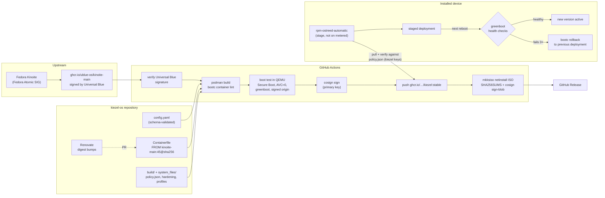

# Architecture

> Phase 0 draft. Filled in as the phases land.

Kiezel is a **bootable container image**. The whole operating system (kernel, systemd, KDE
Plasma, configuration) is built like a container in CI, signed, and pulled by installed
machines as one atomic unit. Applications are Flatpaks from Flathub and live outside the image.

## Build and update pipeline

## Trust chain

1. Fedora signs RPMs and its base image. Universal Blue signs `kinoite-main` with cosign.
2. CI checks Universal Blue's signature **before** building on top of it.
3. CI signs the Kiezel image with Kiezel's primary key; the signature is logged in Rekor.
4. Devices accept only images from `ghcr.io/elstvictor05-droid/kiezel` signed with Kiezel's
   primary or backup key (ADR-0003, ADR-0004).
5. The installer ISO is Fedora's Secure-Boot-signed netinstall image. Our kickstart makes the
   install-time pull verify against Kiezel's key too (ADR-0005).

## Decisions

See [`docs/adr/`](adr/).
